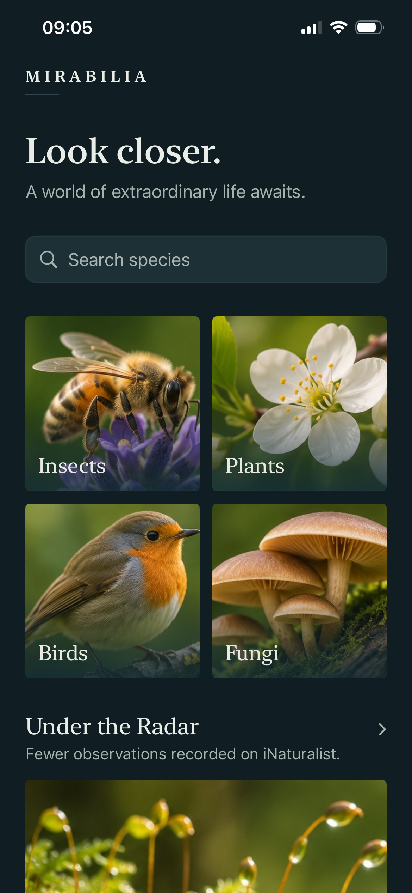
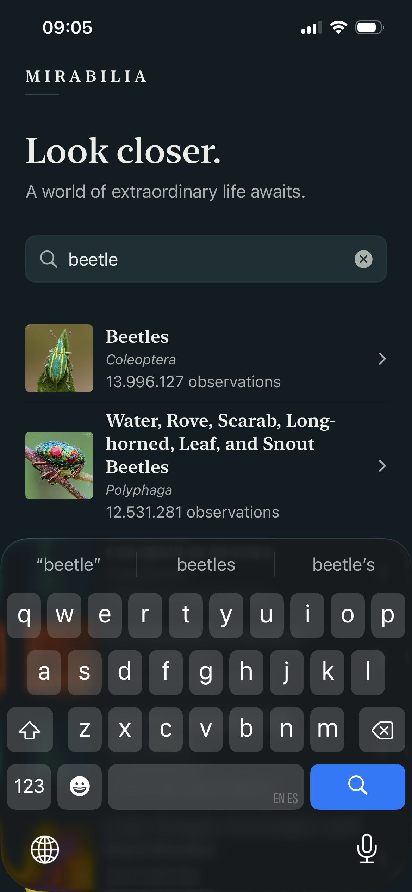
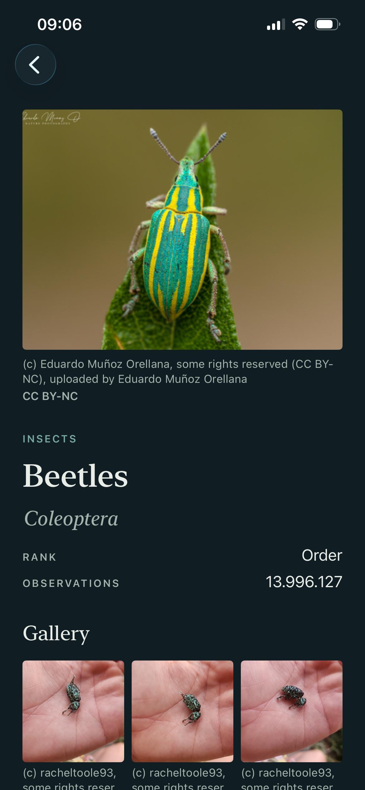

# MIRABILIA

**Discover the extraordinary in nature.**

MIRABILIA es una aplicación nativa de iOS para descubrir organismos documentados por la comunidad de [iNaturalist](https://www.inaturalist.org). La fotografía es la protagonista; la información taxonómica y el número de observaciones aportan contexto. No es una aplicación oficial de iNaturalist ni una herramienta de identificación.

## Funcionalidad

- **Explore:** pantalla de inicio estática. No realiza peticiones de red al abrirse.
- **Búsqueda** por nombre común o científico, con debounce y cancelación.
- **Cuatro grupos:** Insects, Plants, Birds y Fungi, cargados al entrar en cada uno. Solo se muestra la primera página de resultados de cada lista.
- **Under the Radar:** organismos con *menos observaciones registradas en iNaturalist*. Es un dato de la plataforma; no implica que sean biológicamente raros ni amenazados.
- **Species Detail:** fotografía principal (4:3), nombre común y científico, rango, grupo, número de observaciones y galería de fotografías con autor y licencia. Cada foto de la galería se puede ampliar y abrir a tamaño completo.

## Capturas

| Home | Búsqueda | Detalle |
|---|---|---|
|  |  |  |

## Requisitos

- iOS 17.6 o superior (iPhone; el proyecto también admite iPad).
- Swift 6 (lenguaje en modo Swift 6).
- Xcode 26 (el proyecto fue creado con Xcode 26.3).
- Sin dependencias externas.

## Cómo abrir y ejecutar

1. Abrir `MIRABILIA/MIRABILIA.xcodeproj` en Xcode.
2. Seleccionar el esquema `MIRABILIA` y un simulador o dispositivo con iOS 17.6 o superior.
3. En *Signing & Capabilities*, elegir tu propio equipo de desarrollo si vas a ejecutar en un dispositivo.
4. Ejecutar con `⌘R`.

Necesita conexión a Internet para buscar, abrir listas y cargar fotografías.

## API pública

Se utiliza la [API v1 de iNaturalist](https://api.inaturalist.org/v1/docs/), sin autenticación ni claves:

| Uso | Endpoint |
|---|---|
| Búsqueda | `GET /taxa?q=…&locale=…&per_page=25` |
| Exploración de un grupo | `GET /taxa?taxon_id=…&rank=species&order_by=observations_count&order=desc&per_page=100` |
| Under the Radar | `GET /observations/species_counts?taxon_id=…&rank=species&order_by=observation_count&order=asc` (una petición por grupo) |
| Galería | `GET /observations?taxon_id=…&photos=true&photo_license=…&per_page=50` |

La decodificación es tolerante: un elemento mal formado dentro de `results` se descarta sin perder el resto de la lista, y `total_results` es opcional.

Las peticiones envían un `User-Agent` genérico (`MIRABILIA/1.0 (iOS)`) y el `locale` del idioma del sistema.

## Arquitectura

Tres capas con dependencias en un solo sentido (Presentation → Domain ← Data):

```
MIRABILIA/MIRABILIA/
├── App/            Punto de entrada y composición de dependencias
├── Domain/         Entidades, protocolos de repositorio y casos de uso
├── Data/           Cliente HTTP, DTOs, mappers, repositorios y caché
├── Presentation/   Vistas SwiftUI y ViewModels (MVVM)
└── Resources/      Assets
```

- **Domain:** `Taxon`, `TaxonPhoto`, `TaxonGroup`, `Observation`; protocolos `TaxonRepository` y `ObservationRepository`; `SearchTaxaUseCase`. No conoce iNaturalist.
- **Data:** `iNaturalistClient` (sobre un `HTTPTransport` inyectable), DTOs, `TaxonMapper`/`ObservationMapper`, `PhotoPolicy`, `TaxonGroupIDs` (los IDs de iNaturalist no salen de esta capa) y `SearchCache`.
- **Presentation:** `SearchViewModel`, `ResultsViewModel` y `SpeciesDetailViewModel`. Una única lista reutilizable (`TaxonResultsList`) sirve a búsqueda, grupos y Under the Radar.
- **Inyección de dependencias:** por inicializador, desde `MIRABILIAApp`. Sin singletons ni contenedores.
- **Navegación:** un `NavigationStack` en `ExploreView` con destinos tipados. El identificador del taxon es la identidad de la ruta, y la ficha recibe el `Taxon` ya cargado, de modo que un fallo de la galería no oculta la identidad ni la foto principal.
- **Under the Radar:** ordenar `/taxa` de forma ascendente devuelve primero taxones con cero observaciones, por lo que no sirve. Se usa `species_counts`, con una consulta por grupo ejecutadas en paralelo y combinadas de forma intercalada. Es una selección equilibrada entre grupos, no un ranking global exacto: los empates en los valores más bajos no tienen orden significativo.
- **Observaciones:** el número mostrado procede siempre de `observations_count` del taxon. El `count` de `species_counts` solo se usa para ordenar y se consulta sin filtros de foto o calidad para que sea comparable.

## Concurrencia y cancelación

- Swift 6 con comprobación estricta de concurrencia. El aislamiento por defecto del proyecto es `nonisolated`; los ViewModels y las vistas están aislados en `@MainActor`.
- Los modelos de Domain son `Sendable`; el estado mutable de la caché vive dentro de un `actor`.
- **Búsqueda:** cada cambio de consulta cancela la tarea anterior, espera 300 ms (debounce) y lanza la nueva. Las consultas vacías no se envían y las repetidas consecutivas (tras recortar espacios) no se repiten. Limpiar el campo cancela la búsqueda y vuelve al estado inicial.
- **Respuestas obsoletas:** tras el `await`, el ViewModel comprueba `Task.isCancelled` antes de escribir el estado, de modo que una respuesta antigua no puede sobrescribir una más reciente aunque llegue tarde.
- La cancelación se propaga hasta `URLSession` y no se convierte en un error genérico.
- **Reintentos:** un «Try again» pulsado mientras ya hay una carga en curso se ignora, de modo que no se lanzan peticiones duplicadas.
- Las pantallas de grupo, Under the Radar y galería cargan al aparecer; si se cancelan al salir, vuelven a cargar al regresar.

## Caché

- En memoria, solo para búsquedas, sin persistencia en disco.
- Clave: consulta normalizada (espacios recortados) + locale.
- TTL de 3 minutos. El reloj es inyectable para poder probar la expiración sin esperas.
- Los errores y las búsquedas canceladas no se almacenan.
- Las listas de grupos y Under the Radar y la galería no se cachean.

## Fotografías, licencias y atribución

La política vive en `PhotoPolicy` (Data) y se aplica en los mappers, antes de que una foto llegue a Presentation:

- Solo se aceptan estas licencias: `cc0`, `cc-by`, `cc-by-sa`, `cc-by-nc`, `cc-by-nc-sa`, `cc-by-nd` y `cc-by-nc-nd`. Una foto sin licencia o con una licencia desconocida se descarta.
- Para las fotos de observaciones se usa la licencia de cada foto, no la de la observación.
- La URL `square` de la API se convierte a `medium` para mostrar y a `large` para abrir a tamaño completo.
- **Atribución:** el autor y la licencia de cada foto se muestran junto a la imagen (foto principal, galería y visor ampliado).
- **Licencias ND:** estas fotografías no se recortan; se muestran completas, sin modificar su encuadre.
- Si no hay una foto válida se muestra un recurso gráfico local (fallback editorial). Ese recurso no procede de iNaturalist.

## Tests

Los tests usan **Swift Testing** y no dependen de la API real: el transporte HTTP y los repositorios se sustituyen por dobles inyectados.

- Domain: `SearchTaxaUseCase`.
- Data: cliente HTTP (URL, parámetros, errores, decodificación y cancelación), mappers, `PhotoPolicy`, caché (acierto, fallo y expiración con reloj inyectado) y repositorio de taxones (búsqueda y Under the Radar).
- Presentation: `SearchViewModel` (debounce, cancelación, respuestas obsoletas, errores y limpieza), `ResultsViewModel`, `SpeciesDetailViewModel` y `PhotoLicense`.

Para ejecutarlos desde Xcode: seleccionar el esquema `MIRABILIA` y pulsar `⌘U`, o abrir el Test Navigator (`⌘6`) y ejecutar la suite `MIRABILIATests`.

La integración continua (GitHub Actions, `.github/workflows/ci.yml`) compila y ejecuta los tests en cada push a `main` y en cada pull request, con Xcode 26.3 en un simulador de iPhone 17.

## Créditos

Los datos y las fotografías proceden de la comunidad de iNaturalist. Cada fotografía conserva la atribución y la licencia de su autor.
